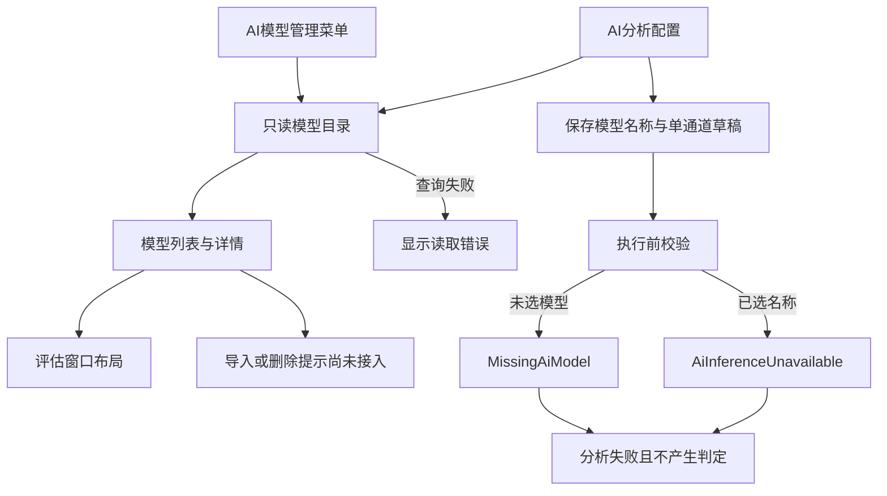

# AI 模型管理与配置入口

## 当前范围

本次提供模型登记信息的只读展示、AI 分析配置草稿以及未接入推理时的明确失败状态。模型导入、删除、音频评估和实际推理尚未实现，不新增 TensorFlow、Keras 或 ONNX Runtime 依赖。

“功能 → AI模型管理”沿用工程师和管理员权限；操作员可见但不可点击。模型管理窗口读取既有登记信息，不自动创建数据库或复制模型文件。

## 模型管理界面

- 模型列表显示模型名称、输入维度、输出维度及模型文件存在性。名称与文件名去掉扩展名后相同时，仅显示居中的模型名称；名称不同时保留文件名作为第二行。完整路径保留在悬停提示和详情中。
- 导入模型、模型评估、删除模型使用一致的浅色按钮。导入和删除可以点击，分别提示“模型导入功能尚未接入。”和“模型删除功能尚未接入。”，不执行文件或数据库修改。
- 模型评估在选中记录时可打开评估窗口。窗口中的音频选择和开始评估保持禁用，指标显示为 `—`，结果列表为空；历史准确率仅在详情中展示，不作为本次评估结果。
- 详情显示登记字段、模型及配置文件路径和存在性。长路径与备注支持换行、滚动和复制。
- 数据库缺失时显示空列表；查询失败单独显示错误，不伪装成成功空列表。

## 配置与执行边界

AI 配置窗口支持单通道选择、已登记模型选择、保存默认值和恢复配置。保留 `analyse_model_name` 与 `analysis_channel` 字段，允许未选择模型的草稿保存。旧配置引用不可用模型时保留名称，取消编辑不修改原配置。

候选模型仅依据 `.onnx` 扩展名和文件存在性允许选择。旧 Keras 文件、缺失文件和配置中已失效的模型保持不可选状态。文件存在不代表模型格式、输入契约或推理兼容性已验证。

执行入口仍阻断 AI：

- 旧分析入口和任务构建器通过 `for_execution=True` 校验，阻止 AI 草稿进入算法调用。
- 当前分析输入适配器为 AI 生成准备问题；执行器返回明确失败。
- 未选择模型时返回 `MissingAiModel`；已选择名称但推理未接入时返回 `AiInferenceUnavailable`。两者均无 OK/NG 判定、无计算指标。

## 职责划分

| 模块 | 职责 |
| --- | --- |
| `base/ai_model_catalog.py` | 只读查询既有 `training_model_table`、映射登记字段、检查文件存在性；不加载模型。 |
| `base/analysis_config_validation.py` | 校验 AI 配置，提供缺少模型及推理未接入的执行阻断原因。 |
| `ui/ai/model_manager_dialog.py` | 模型列表、详情、选择状态和占位操作提示。 |
| `ui/ai/model_evaluation_dialog.py` | 评估布局及未接入状态，不生成模拟结果。 |
| `ui/ai/model_dialog_base.py` | 模型窗口的局部主题、表格及名称绘制。 |
| `ui/ui_analysis_config/ai_config_dialog.py` | 编辑配置草稿，通过注入目录服务获取候选模型。 |
| 主窗口及队列窗口 | 注入目录服务，绑定菜单权限和配置入口。 |
| 配置校验、分析输入适配器及执行器 | 区分可保存草稿与可执行配置，阻断尚未实现的 AI 推理。 |

## 后续接入

真实推理接入前，需要确定模型标识与版本、采样率、输入长度、通道、预处理、输入输出张量以及标签契约。模型包导入和删除应由应用服务管理文件与登记记录，界面只提交用户意图。评估执行应使用明确标注的样本，并与登记表中的历史准确率分离。

## 验证范围与限制

回归覆盖模型目录只读行为、缺失及损坏数据库、旧模型格式、配置草稿和默认值、取消编辑、菜单权限和重复绑定、详情与选择对应、评估未执行状态、AI 执行失败及既有规则分析。

界面使用测试记录进行离屏渲染检查，不向生产数据库写入示例数据。真实模型导入、推理、评估和硬件采集均不在本次验收范围内。
