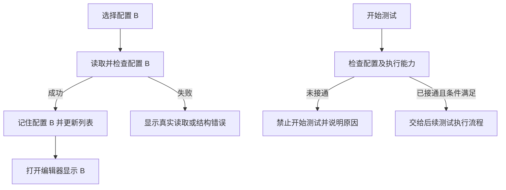

# 产品测试配置改造实施方案

更新日期：2026-11-06。
状态：配置阶段收尾及提交范围核对已完成，可以提交产品测试配置阶段代码；尚未暂存或提交。复选框使用 Qt 控件绘制，不需要新增图片。当前不具备多工位测试执行能力。

## 1. 本阶段范围

前端负责草稿编辑、控件展示和交互；后端负责字段规则、引用检查、配置读写及失败恢复。两者通过普通 Python 调用连接，不新增 HTTP 服务或通信进程。

本阶段不实现测试流程控制器、自动化设备适配、采集进程重构、工位分析调度或实时曲线。新配置不得进入不兼容的旧执行流程，但执行能力缺失不能阻止配置管理。

阶段验收要求包括：新建、保存、另存、导入、删除，以及在多份已保存配置之间切换并重新编辑。已补充多份已保存配置切换、编辑、保存和重新打开的回归检查。

## 2. 已确认的数据约定

```text
project_id
project_name
result_root_directory
stations[]
  station_id
  station_name
  channels[]
    channel_id
    channel_name
    signal_type
    hardware_channel
      device_ref
      physical_channel_index
conditions[]
  condition_id
  condition_name
  applicable_station_ids[]
  trigger_state
  test_queue
  segmented_analysis
```

- 工位代表被测产品；工况为项目级公共列表，通过 applicable_station_ids 关联工位。
- project_id、station_id、channel_id、condition_id 使用 uuid4 生成；改名不改变 ID。另存为独立项目时生成新 ID 并重建内部引用。
- 文件使用项目名称命名，例如 `电机A.json`，不追加短编号；完整 project_id 保留在文件内部，注册表保存身份、名称和文件关联。
- 项目名称去除首尾空白后作为文件名；保存时校验 Windows 非法字符、保留名称、结尾句点、文件名长度及注册表保留文件名。同目录文件名按不区分大小写检查，重名提示修改名称，不覆盖其他项目。
- 修改项目名称并保存时更新文件名、注册表及活动文件引用，项目 ID 不变；非活动项目改名不切换当前使用配置。另存为独立项目必须使用不同名称，并重建 ID。
- 现有 UUID 文件名可正常读取，再次保存该配置时转换为项目名称文件名；不批量改动已有文件。该兼容仅指当前 stations/conditions 格式，不代表迁移旧 test_groups 格式。
- 改名时先写入新配置、更新注册表，成功后移除旧文件；处理到的写入或旧文件移除失败会恢复原文件/注册表并报告失败。此流程不提供跨文件断电事务保证。
- 通道默认命名 CH1、CH2 等，可以重命名。signal_type 当前支持 sound_pressure 和 acceleration，不硬编码工位通道数量或传感器比例。
- channels 数组顺序就是该工位 WAV 的通道顺序。界面序号从 1 开始，数据下标从 0 开始，不另存可漂移的 WAV 序号。
- channel_id 标识逻辑记录；分析项按 WAV 位置选择通道，不通过 channel_id 自动追踪位置变化。
- 通道只追加、移除，不提供上下移动。移除前提示后续位置变化和受影响队列。
- hardware_channel 引用已有硬件信息，不复制采样率等设备参数；device_ref 由现有设备快照解析。
- trigger_state 保留为协议中立文本。自动化协议解析不进入产品字段校验。
- result_root_directory 保存结果根目录；具体录音文件路径属于运行记录。
- 不增加 schema_version、product_id；移除电压、原始音频 WAV/CSV 选择、复制工况到端口功能。

产品配置中的分段分析仅支持：

```json
{"mode": "none"}
```

```json
{"mode": "time", "interval_seconds": 2.0, "analysis_seconds": 1.0, "display_time_unit": "s"}
```

时间单位支持 s、min、h。按输出负载的选项、输入控件及产品配置支持已移除。公共分段模块保留历史负载解析，不在本阶段扩大清理范围。

## 3. 测试队列衔接

保留原测试队列编辑界面及新建、导入、另存为、删除、保存操作。各分析项继续保存自己的 analysis_channel / analysis_channels。

合法录音参数且无分析项的队列属于“仅录音”配置，允许在工况中选择和保存；判定与分析列显示“仅录音”，不标为不可用，也不具备自动 OK/NG 判定能力。文件损坏、录音参数错误或已列出的分析项不存在仍视为配置错误。

例如 SPL 选择界面“第 2 通道”，数据下标为 1；工况适用工位1、工位2时，分别取工位1 WAV 的第 2 通道、工位2 WAV 的第 2 通道。各工位对应的硬件物理通道可以不同。

不再增加“另存为 WAV 通道队列”入口，不重置分析通道，也不要求普通队列新增 analysis_channel_basis 字段。当前代码仍可读写早期试制配置中已有的该字段，并保留相关保护；它不是新配置的必填字段或用户操作步骤。

共用队列的工位，队列所用 WAV 位置必须用途一致。程序检查通道存在性及已知信号类型要求；振动轴向、安装位置等实际用途仍需配置人员确认。

队列候选修改需要检查已保存项目和当前草稿的引用。草稿不能遮蔽磁盘上仍有效的引用，取消父窗口草稿后不能留下与已保存映射不匹配的队列。

队列编辑不要求父产品草稿已填完项目名称、结果目录或尚未建立的通道映射。草稿已有通道的工位仍检查分析通道匹配，已保存产品继续完整校验；产品必填字段在保存产品配置时检查。子参数窗口确认后触发的自动保存失败只保留队列未保存状态并记录日志，主动保存队列时再显示错误，不在录音参数确认后弹出产品字段错误。

部分产品配置无法读取或工况结构损坏时，可读取的相关配置和当前草稿仍须执行通道校验。明确的通道错误在共享确认前阻止保存，原文件保持不变；未完成检查的配置沿用共享保存提示，不得因此跳过其他配置的检查。

## 4. 模块职责

| 模块 | 职责 |
|---|---|
| base/product_test/config_model.py | 默认数据、ID、草稿结构操作、规范化、硬件快照引用 |
| base/product_test/config_validation.py | 产品结构、工位引用、队列通道及分段校验 |
| base/product_test/queue_context.py | 队列通道选择上下文、候选队列与引用项目校验 |
| base/product_test_project_config.py | 管理入口、注册表、加载、保存、另存、导入及失败恢复 |
| base/test_queue_catalog.py | 复用并提取的队列读取与摘要 |
| base/load_config.py | 复用既有 JSON 读写 |
| base/sequence_queue_references.py、base/config_deletion.py | 引用扫描及删除保护 |
| ui/product_test_project_config_dialog.py | 窗口操作协调 |
| ui/product_test/ | 工位、通道映射、公共工况、滚动标签及局部样式 |
| ui/operation_sequence.py | 原队列编辑器及产品上下文适配 |
| ui/output_load_config_dialog.py | 分段设置；现仅提供不分段和按时间，文件名保留 |
| base/product_test_runtime_policy.py | 移出的旧运行期规则，供尚存调用方使用 |

模型与产品校验模块不导入 PyQt、不启动硬件、不读取串口。复用现有 JSON 临时文件替换及失败恢复机制，不将其视为跨文件并发事务框架。

被替代的 base/product_test_program_config.py、ui/product_test_program_config_dialog.py 及旧格式专用测试已删除。用户旧 JSON、录音、结果和数据库不自动删除或迁移；旧结构明确报错。

## 5. 界面规则

- 保留浅蓝分区、浅灰背景；统一使用系统已有宋体 SimSun，不新增字体资源。
- 工位数量控制工位增减；工位标签只切换通道映射，双击可重命名。下方工况表始终为公共列表。
- 工位通道映射默认显示一行待填写通道，随内容增长，最多显示四行，超过后滚动；剩余高度优先给工况列表。
- 适用工位使用白底多选菜单，空框表示未选，框内对号表示已选。
- 分段分析位于最后一列，只保留不分段和按时间。
- 通道移除使用关闭图标及确认；工位减少清理适用工位引用并保留工况。
- 工位标签重建时立即隐藏旧按钮，再延迟释放，避免模态窗口中旧按钮与新按钮叠加。

## 6. 配置管理与测试执行边界

目标行为：选择、保存配置不依赖测试执行能力；真正开始采集或分析时才检查执行条件。



以下为已修复问题的原始复现步骤：

1. 已保存 A、B 两份配置，活动配置为 A。
2. 主界面选择 B 时，代码先构建测试执行快照。
3. 新执行流程未接通，构建快照抛出限制异常，选择被退回。
4. 注册表仍指向 A；再次打开产品配置编辑器仍显示 A。

修正已实施：配置选择路径单独识别执行尚未接通的状态，允许读取成功的配置更新活动选择；列表刷新及失败回退保留该选择。文件无法读取或注册表写入失败时仍拒绝切换。工位、工况、通道字段未改动，测试入口仍禁用。A→B→打开编辑器→修改保存→重新打开→切回 A 的回归已通过。

已完成的提示修正：保存成功后不再因已知执行限制弹出“请修正配置”；打开主界面不再将该限制当成缺少配置自动弹窗；测试按钮保持禁用并说明原因。真正的文件、结构和保存错误仍需提示。

## 7. 验证和提交前工作

### 通道映射默认行调整（2026-11-06）

- 新建项目、新增工位时默认创建一行 CH1；新增通道同样不预设信号类型或绑定硬件。此行属于未完成草稿，保存前必须选择信号类型和硬件通道。
- 保留原表头和布局；表格按实际内容显示一至四行，超过四行滚动。取消空白区域及额外的“尚未添加通道”提示。
- 只剩一行时禁用移除按钮，并提示至少保留一个通道；多行删除保留原确认和序号前移规则。
- 现有已保存配置原样加载，不重建通道或改变映射。配置字段及 WAV 通道顺序约定不变。
- 草稿中的未选信号类型不作为已确定的分析映射；已确定的通道继续检查，已保存产品仍执行完整校验，不能利用空白草稿绕过磁盘引用。
- 验证新建/新增工位、占位填写与保存、删除至最后一行、五行滚动、旧配置加载和共享队列保存边界；实际 Qt 截图检查一行与四行布局。

| 场景 | 验收要求 |
|---|---|
| 单工位和多工位 | 字段可保存和加载，不依赖固定通道比例 |
| 改名、另存、导入 | ID 和引用按约定保持或重建，失败不误覆盖 |
| 工位减少、通道移除 | 确认有效，取消保留草稿，受影响引用可检查 |
| 共享队列修改 | 保留各分析项选择，检查保存项目和草稿引用 |
| 原队列直接使用 | 不要求转换，不新增必填标记，不重置通道 |
| 多份配置切换编辑 | 选择 B 后打开 B，保存及重开正确；失败保留原选择，测试仍禁用 |
| 保存和主界面显示 | 已知执行限制不导致误导警告，真实错误仍提示 |
| 已保存配置的模态窗口 | 每工位只显示一个按钮，切换和改名正常 |
| 不分段与按时间 | 参数往返正确，无效间隔被拒绝 |
| 测试入口 | 新执行未接通时不得进入旧录音和分析链路 |

2026-11-06 默认通道行调整后的回归：703 passed、1 skipped、1 warning、18 subtests passed，67.59 秒。涵盖产品配置、共享队列、配置切换、Vking 设置工作流及公共样式。跳过项因 Windows 无创建符号链接权限，警告为既有 cgi 弃用提示。此前两个 Vking 工作流测试已按当前接口修正并通过，未修改量程控件或录音业务规则。随后仅加宽信号类型列，配置窗口回归 19 passed（5.22 秒）；具体命令和证据见实施记录第 12、13 节。

提交范围：

1. 配置主体、保存和切换修正、共享队列校验、旧模块清理及操作链回归。
2. 适用工位使用 QCheckBox，由 Qt 绘制方框和对号；不提交已不再引用的 check.svg。
3. 已核对提交清单、删除项和公共样式影响。产品配置主体与公共字体/下拉样式建议分开提交，两份实施文档同步纳入。
4. 临时截图、诊断脚本、用户配置、日志和录音不纳入提交。

本阶段没有接通实际多工位执行，没有进行硬件、打包、节拍和长时间运行验收。没有执行 Git 暂存、提交或推送。

额外的 PCM24 流水线测试有 3 项既有失败，已在 HEAD 22883b568f382089bf4de4724c137c3229f81ecb 的隔离快照复现相同断言：测试仍要求主录音生成 sample_digest，而当前主录音使用最终波形包。该测试文件及录音实现本轮均未修改，作为单独的测试维护事项记录，不计为本轮产品配置回归。

### 最新基线集成（2026-11-06）

提交分支以远端 develop_hsdk 的 58815a5 为基线，在独立工作目录整合变更，保留最新工作台控制器及主窗口刷新结构。最终候选 52 个文件；新增一项主窗口集成测试文件的接口适配，公共字体/下拉样式与配置主体分开提交。

最新相关集合结果为 805 passed、1 failed、1 skipped；公共样式在 offscreen 环境下为 17 passed、9 subtests passed。默认布局文件缺失和 Windows 原生 tooltip 显示用例失败均已在未修改的 58815a5 快照复现，未通过放宽业务校验消除失败。完整说明见实施记录第 14 节。本节替代此前“尚未开始 Git 提交”的阶段状态；最终提交及 PR 地址以实际结果为准。
