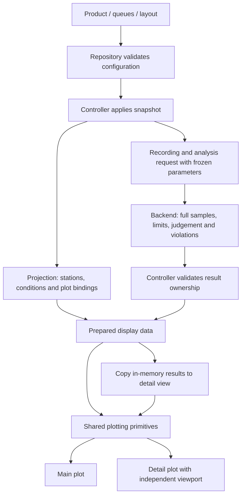

# Shared workbench plotting

## Scope

The main workbench and enlarged detail view render the same prepared result data through `ui/plotting`. The latest `develop_hsdk` removed the standalone signal-analysis, reference-spectrum and manual multichannel result windows; this change does not restore them. Analysis configuration dialogs remain supported.

## Configuration ownership

| Source | Responsibility |
| --- | --- |
| Active product and referenced test queues | Station order, applicable conditions, analysis instances, channels, algorithm parameters and judgement rules |
| Analysis item `display` | Main/upper/lower colors and `show_threshold_lines` (defaults to true for existing configurations) |
| `ui/ui_config/motor_workbench_plot_layout.json` | Selected plots, rows, channel filtering, axis ranges, grid/legend and display sampling |
| Backend result | Full measured samples, resolved limits, units, verdict and violation intervals |

The configuration repository reads and validates the product, queues and layout. The controller holds the applied snapshot; recording/analysis requests retain their frozen configuration and task identity. Layout selection does not change the analyses executed. Invalid configurations follow the existing error path instead of partially applying settings.

## Layout v2 and deployment

`examples/motor_workbench_plot_layout.v2.json` is an explicit deployment example, not an automatically loaded default. To adopt it, merge the desired settings into the deployed `ui/ui_config/motor_workbench_plot_layout.json`, after retaining the site's existing configuration. Set each `analysis_item_name` to the actual queue key. Copying the example unchanged does not create those analysis items.

V2 uses `schema_version: 2`, `column_source: product_stations` and one `row_templates` entry per row. Columns follow the product's station count and order. It rejects competing `limit_lines` and `exceedance_highlight` style definitions for analysis-result plots. Analysis colors and shared algorithm pen conventions apply instead. Simulated channel styles remain independent.

The example enables SPL and **simulated vibration RMS** rows; FFT and spectrogram templates are available but inactive until selected in `row_templates`. The simulated row is a display demonstration, not a real vibration measurement. LOUD line templates are supported; ROUGH/SHRP have shared payload-contract tests only, not new algorithm integrations.

Existing v1 layouts remain supported with their legacy style overrides; there is no automatic migration or overwrite. A missing runtime layout still produces an empty plot area while product/queue loading and analysis remain available. An invalid existing layout is reported as a configuration error.

## Thresholds, highlighting and judgement

The configuration checkbox is the first row inside **曲线显示设置**, under **显示参数**. `display.show_threshold_lines` only hides upper/lower reference curves and their legends. It does not disable threshold evaluation, discard limits, hide exceedance highlights or alter a verdict. Main and detail views receive the same flag for each condition.

Curve-mode highlights use backend violation intervals on the original samples. Isolated violations have visible markers. Limits and highlights are not display-downsampled. Scalar limits can be horizontal references only when their units match the displayed axis; scalar NG does not turn instantaneous peaks into pointwise violations. Integrated specific-loudness limits are not placed on a loudness-time axis.

LOUD preserves raw samples for judgement and export, with a separate `plot_curve` for segment-edge extension and visual limits. Unit mismatches suppress incompatible limits/highlights without changing the backend verdict. CSV gaps and non-overlapping domains retain the existing backend semantics; this change does not revise judgement policy.

FFT delta mode does not overlay an absolute reference spectrum; overlay mode retains the gray reference. Fixed axis clipping preserves segment intersections and NaN gaps. Spectrogram rendering uses physical time/frequency bin edges, including logarithmic frequency placement, with the full calibrated matrix retained.

## Detail views and sampling

Opening a detail view creates another plot widget and renders the in-memory data. It does not reread WAV/CSV, run algorithms or repeat judgement. Source updates and clears synchronize to the detail view; disposing the source closes it. Each viewport samples independently from full data, so its visible point count can differ. Full samples determine automatic ranges; rendering reduction never changes CSV output or judgement.

## Station titles

Final station results come from `WorkbenchResultState`, not plotted peaks. The 44px neutral title strip keeps the station name dark, highlights only OK/NG text, and adds a thin matching bottom border. An accepted new round clears the result; rejected recording attempts and later conditions of the same round do not. Old or unrelated results cannot recolor the current station header.

## Verification

Regression coverage includes configuration round trips, dynamic station columns, real WAV FFT/LOUD limits, main/detail visibility and highlighting, clipping and sampling, spectrogram bin coordinates, station-result lifecycle, current-request routing and retained backend judgement contracts. Qt tests use the existing application resources and offscreen rendering. Automated results do not replace hardware acquisition or packaged-application acceptance.
